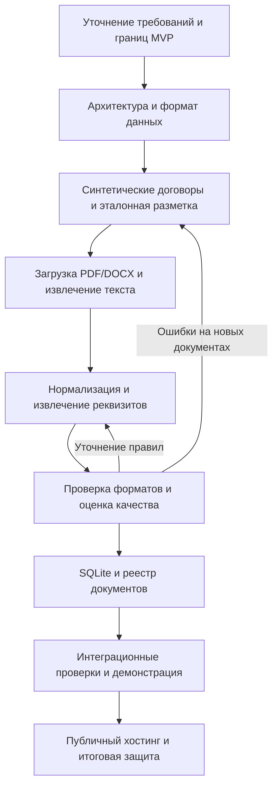
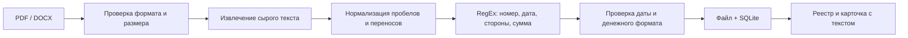

# Пайплайн проекта: извлечение реквизитов договоров

Цель: веб-сервис, в котором пользователь загружает PDF/DOCX и получает запись в реестре с номером договора, датой заключения, сторонами и суммой.

Под «пайплайном» здесь понимаются и порядок разработки всего проекта, и цепочка обработки одного договора. Это рабочий вариант по заданию на скриншоте; точный формат сдачи преподаватель пока не уточнил.

## 1. Порядок разработки

| Этап | Что делаем | Проверяемый результат | Текущее состояние |
|---|---|---|---|
| Требования | Фиксируем входные форматы, поля, ограничения, сценарий пользователя | Согласованные границы MVP | Первый вариант описан ниже |
| Архитектура | Выбираем Flask, парсеры, SQLite, HTML/CSS; разделяем чтение и извлечение | Схема компонентов и структура файлов | Реализован простой вариант |
| Датасет | Создаём разные синтетические договоры и ожидаемые значения | DOCX + `expected.json` | Есть 12 документов, 3 шаблона |
| Чтение | Загружаем файл, читаем абзацы/таблицы DOCX и текст PDF | Исходный текст виден в карточке | Реализовано; сканы требуют OCR |
| Извлечение | Ищем реквизиты правилами; приводим дату и сумму к единому виду | Структурированные поля + предупреждения | Базовые правила реализованы |
| Оценка | Сравниваем поля с разметкой, разбираем ошибки | Отчёт по каждому полю | Есть скрипт; независимой выборки ещё нет |
| Реестр | Сохраняем файл, текст, поля и статус | Данные сохраняются между запусками | Реализовано на SQLite |
| Улучшение интерфейса | Добавляем исправление полей, поиск, фильтры | Удобная работа с реестром | Следующий этап |
| Развёртывание | Настраиваем сервер, HTTPS, постоянное хранилище, доступ | Рабочая публичная ссылка | Не выполнено |
| Защита | Показываем сценарий и ограничения, результаты оценки | Демо + инструкция + отчёт | Материалы первого запуска готовы |

## 2. Цепочка обработки договора

1. **Вход:** один PDF/DOCX. Лимит HTTP-запроса — 10 МБ; PDF — до 100 страниц. DOCX после распаковки — до 30 МБ.
2. **Чтение:** `pypdf` читает текстовый слой PDF; `python-docx` читает абзацы и таблицы в порядке документа. Колонтитулы и вложенные таблицы отдельными правилами пока не обработаны.
3. **Нормализация:** сохраняем сырой текст; отдельно выравниваем пробелы и переносы для парсера.
4. **Извлечение:** ищем номер в заголовке, дату заключения, явно подписанные стороны или типовую преамбулу, общую сумму по подписи. Аванс и другие суммы не используются как замена общей стоимости.
5. **Форматы:** дата хранится как `YYYY-MM-DD`; сумма — десятичной строкой, например `125000.50`. В базе нет денежных вычислений через `float`.
6. **Пропуски:** неизвестное значение — `NULL`, в интерфейсе — «Не найдено». Статус `review` означает пропуски; `extracted` — наличие всех полей, а не подтверждённую правильность.
7. **Сохранение:** оригинал получает случайное внутреннее имя; в SQLite сохраняются исходное имя, поля, два варианта текста и предупреждения.
8. **Проверка человеком:** карточка показывает результат и исходный текст. Ручное редактирование реквизитов будет следующим улучшением.

«Стороны» — один атрибут из задания, но в коде представлены двумя полями: `customer` и `contractor`. Итого четыре атрибута и пять отдельных значений.

## 3. Архитектура

| Компонент | Файлы | Ответственность |
|---|---|---|
| Веб-приложение | `app.py`, `templates/`, `static/` | Загрузка, страницы, карточка, скачивание |
| Чтение документов | `contracts/readers.py` | PDF/DOCX → сырой текст |
| Извлечение | `contracts/extractor.py` | Нормализация, RegEx, дата и сумма |
| Пайплайн | `contracts/pipeline.py` | Последовательный вызов этапов |
| Хранение | `contracts/storage.py`, `instance/` | SQLite и оригиналы файлов |
| Данные и оценка | `scripts/`, `data/synthetic/` | Генерация договоров и сравнение с разметкой |
| Проверки | `tests/` | Сценарий загрузки, парсер, сохранение, ошибки |

Для первой версии достаточно одного Flask-приложения и SQLite. Очередь задач, микросервисы и NLP-модель сейчас усложнили бы проект без проверенной необходимости. Если синхронное чтение станет медленным или правила начнут часто ошибаться, это будет основанием добавить очередь либо Natasha/spaCy для конкретных полей.

## 4. Показы по заданию

Недели считаются от начала проекта, календарная дата начала пока неизвестна.

| Показ | Срок | Что демонстрируем | Критерий готовности |
|---|---|---|---|
| 1 | Конец 3-й недели | Архитектура и синтетический датасет | Можно объяснить весь путь документа; у каждого примера есть эталонные поля |
| 2 | Конец 6-й недели | Загрузка и сырой текст | Через браузер загружаются валидные PDF и DOCX; текст виден; плохие файлы дают понятную ошибку |
| 3 | Конец 9-й недели | Извлечение реквизитов | Есть результаты по всем четырём атрибутам и оценка на отдельной выборке |
| 4 | Конец 12-й недели | Полный MVP на хостинге | Загрузка → обработка → сохранение → реестр работает по публичной ссылке |

Часть функций следующих показов уже реализована как прототип. Это не означает, что этапы закончены: ещё нужна независимая оценка и публичное развёртывание.

## 5. Как оценивать качество

- На текущих 12 синтетических DOCX: сравнение каждого значения с `expected.json` командой `python -m scripts.evaluate`.
- Для честной оценки подготовить отдельные 20–30 документов с новыми формулировками, названиями сторон, датами, форматированием суммы и пропусками. Это предложенный следующий шаг, а не требование из скриншота.
- Зафиксировать эту выборку до очередной настройки RegEx. Не использовать её как набор шаблонов генератора.
- Для каждого поля считать долю правильных значений; отдельно учитывать пропуски и ошибочно найденные значения. Полное совпадение всех пяти значений — дополнительная метрика документа.
- Не устанавливать целевую точность без первого замера. Совпадение на собственных шаблонах проверяет работу кода, но не доказывает качество на произвольных договорах.

## 6. Следующие шаги

1. Добавить независимые договоры в датасет и записать реальные ошибки парсера.
2. Добавить ручное исправление полей с сохранением результата проверки человеком.
3. Уточнить необходимость OCR. В задании указаны PDF, но обязательность поддержки сканов не оговорена.
4. Добавить поиск по номеру/сторонам и фильтр документов с пропусками.
5. Подготовить публичное демо с синтетическими файлами: WSGI-сервер, HTTPS, постоянный диск и база, резервное копирование. Для работы с настоящими договорами нужен вход и разграничение доступа к документам.
6. Ввести автоматический запуск проверок при изменении кода, когда появится Git-репозиторий. CI/CD — вспомогательная часть разработки, отдельная от обработки договора.

Если проект делает группа, можно распределить три направления: данные и разметка; чтение и парсер; интерфейс, база и развёртывание. Интеграция и оценка — общая работа после каждого этапа.
